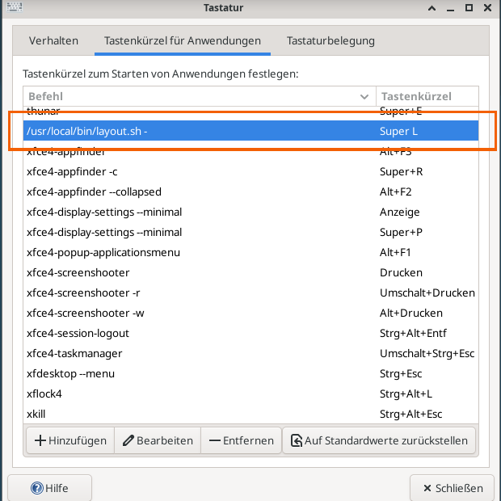
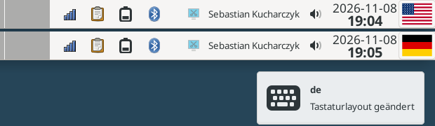

 

 

# The `Windows` key
This key is 'nonsense'. ...

## Using it '**the right way**'
... but I got one on my new laptop, and I like it.

Because all keys can be re-mapped to any functionality/command/.. at least in my
[Linux](https://kernel.org/) operating system. And this is all done very easy
w/in my [`xfce4` Window Manager](https://www.xfce.org/).

### The keyboard layout
I'm using [**`xfce4`**](https://www.xfce.org/) and once wrote
a little [script](#the-script-layoutsh) for this purpose.

I'm from Germany, and sometimes I need to write umlauts (`ue`, `ae`, `oe`, .. and some
other special characters). But I don't want to miss the advantages of the `us` layout,
especially when I'm coding.

 

# The script `layout.sh`
Dependencies are (beneath the [`bash` shell](https://www.gnu.org/software/bash/)):

* [`x11-xkb-utils`](https://packages.debian.org/de/sid/x11-xkb-utils)

> [!TIP]
> `sudo apt install x11-xkb-utils`

The script itself (see my [**Scripts** repository](https://github.com/kekse1/scripts/#layoutsh)):

* [`layout.sh`](./src/layout.sh) v**0.2.1**

 

## Usage
* Call it w/out any parameter to display the current keyboard layout.
* Call it with the concrete layout as parameter (e.g. `us`).
* Call it with `-` as parameter to rotate between configured layouts.

 

## Setup
Since I'm using the [**`xfce4`**](https://www.xfce.org/), it's very easy to setup everything.

Copy [my script](#the-script-layoutsh) to e.g. `/usr/local/bin/layout.sh`. Then go to the `xfce4`
settings (via right click on the desktop, to select `Applications`, then `Settings` and in there
the `Keyboard`, to select the tab `Shortcuts for Applications` (or smth. like this)). There you
can click on the button `Add` to type in the path of [my script](#the-script-layoutsh). Finally
you'll have to capture the key to assign it to [my script](#the-script-layoutsh). Use the `-`
parameter for rotation, otherwise use the concrete layouts as parameter when you use different keys.

  

## Beautify
Xfce got it's own applet for the main bar. Adding this tool to the bar will let you
always see which layout is selected.

   

# Contact

 

# Copyright and License
The Copyright is [(c) Sebastian Kucharczyk](COPYRIGHT.txt),
and it's licensed under the [MIT](LICENSE.txt) (also known as 'X' or 'X11' license).

